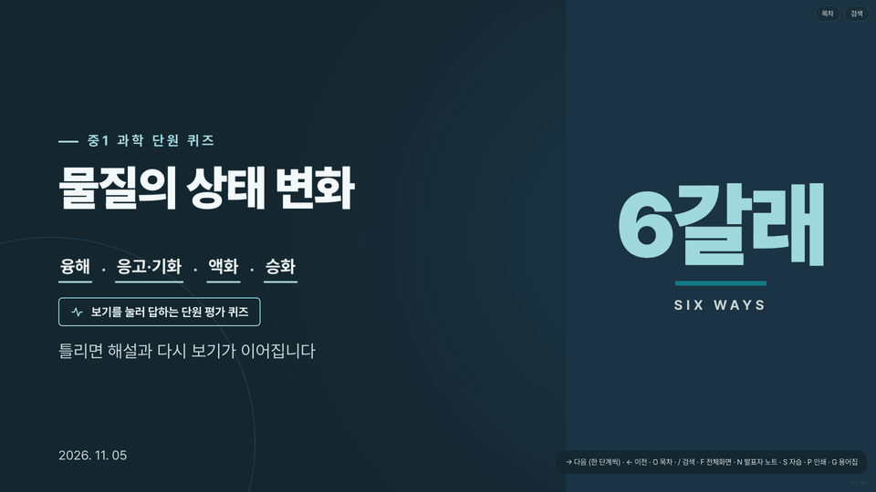
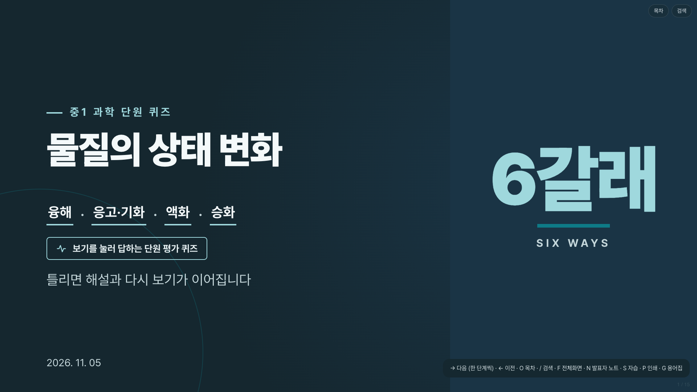
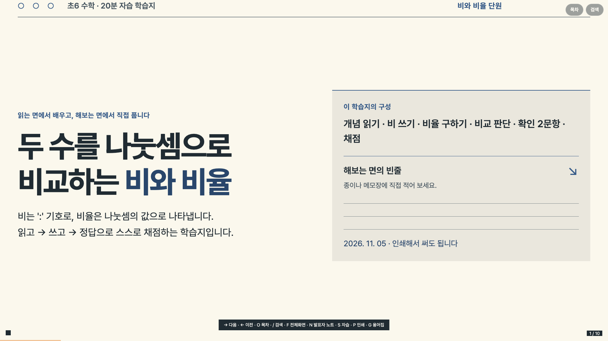
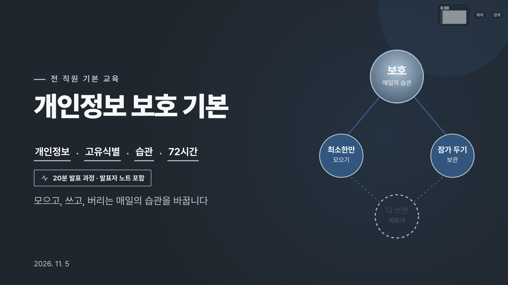
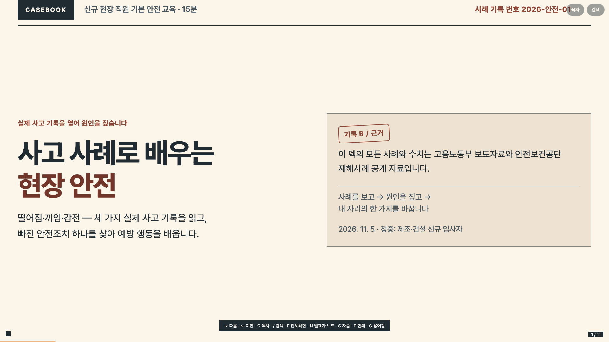
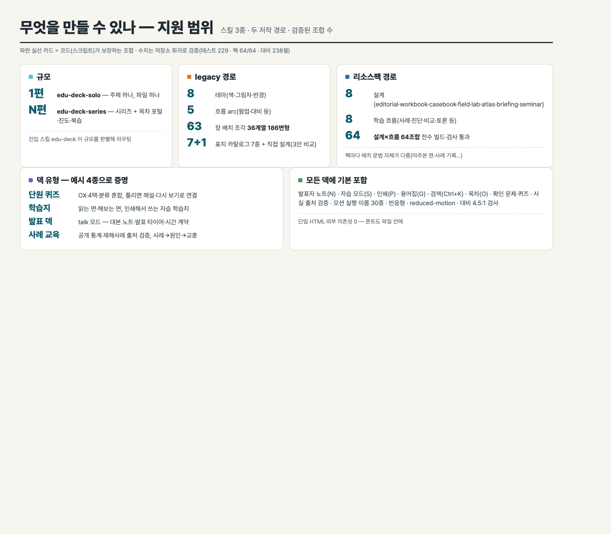
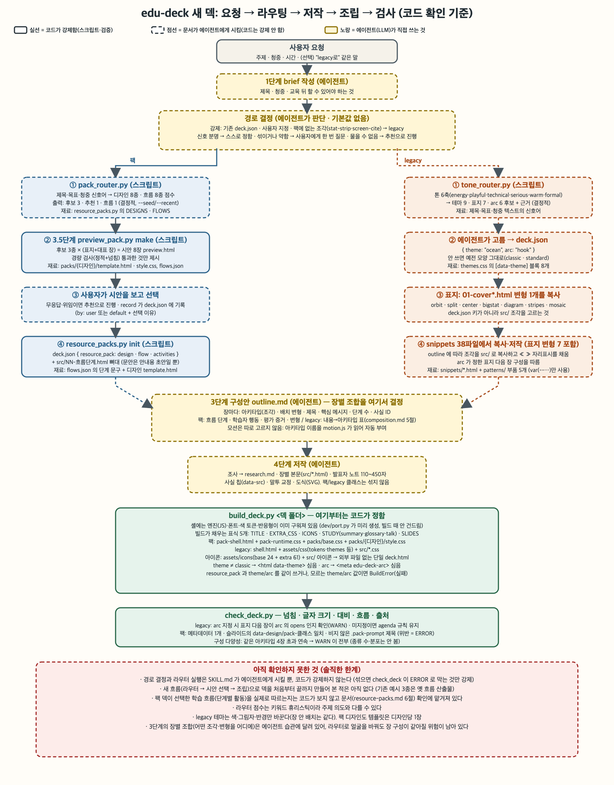
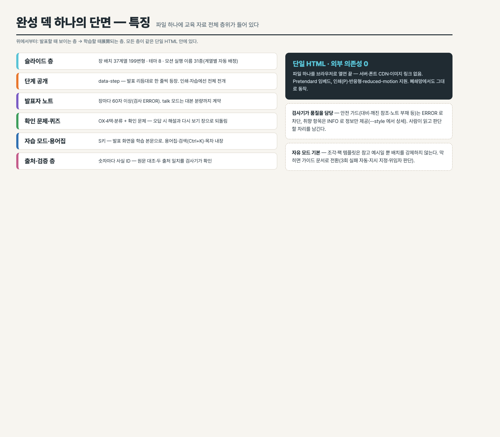

# edu-deck skills — 프롬프트 하나로 한국어 교육 자료

<p align="center">
  <a href="https://gitreels.com/insightflo/edu-deck-skills"></a>
  <br>
  <a href="https://gitreels.com"></a>
</p>

<sub>이전 녹화물: [30초](docs/edu-deck-skills-30-v1.0.0.mp4) · [15초](docs/edu-deck-skills-15-v1.0.0.mp4) · [GIF](docs/reel-loop.gif)</sub>

에이전트 스킬 묶음입니다. "○○ 교육자료 만들어줘" 한 줄이면 조사→구성→저작→검증까지 거쳐 **브라우저에서 바로 쓰는 단일 HTML 교육 덱**을 만듭니다. 퀴즈·학습지·발표 덱·사례 교육 무엇이든, 발표자 노트·자습 모드·인쇄·출처 검증까지 갖춘 상태로 나옵니다.

[](LICENSE)
[](#4-사용법)
[](#2-한눈에-보는-구성)
[](docs/gallery.html)
[](docs/gallery.html)
[](#5-검증--검사기는-계약-품질-판단은-사람)



**[예시 4종](#1-예시-4종--실물)** · **[도식 3장](#2-한눈에-보는-구성)** · **[자산 갤러리](#3-자산-갤러리--재료-전부)** · **[사용법](#4-사용법)**

> 덱 파일은 폰트를 품은 단일 HTML(~3MB)이라 GitHub 내장 뷰어가 못 엽니다. **▶ 버튼(원본 서빙 링크)으로 바로 열어** 보세요. 다운로드는 카드의 `소스` 링크에서.

## 1. 예시 4종 — 실물

모두 이 저장소의 스킬로 만든 완성 덱입니다. 저작 과정 파일(brief·구성안·조사·슬라이드 원본)은 각 폴더에 들어있습니다.

<table>
<tr>
<td width="50%" valign="top">
<a href="https://insightflo.github.io/edu-deck-skills/examples/states-quiz/물질의상태변화-단원평가퀴즈-교육자료.html"></a>
<b>물질의 상태 변화 단원 퀴즈</b> · 중1 과학 · 15장<br>
<sub>가이드 모드 · OX·4택·분류 퀴즈 혼합 · 틀리면 해설·다시 보기로 연결</sub><br>
<sub><a href="https://insightflo.github.io/edu-deck-skills/examples/states-quiz/물질의상태변화-단원평가퀴즈-교육자료.html">▶ 재생</a> · <a href="examples/states-quiz">소스</a></sub>
</td>
<td width="50%" valign="top">
<a href="https://insightflo.github.io/edu-deck-skills/examples/ratio-worksheet/비와-비율-학습지.html"></a>
<b>비와 비율 학습지</b> · 초6 수학 · 10장<br>
<sub>리소스팩 workbook · 읽는 면/해보는 면 · 인쇄해서 쓰는 자습 학습지</sub><br>
<sub><a href="https://insightflo.github.io/edu-deck-skills/examples/ratio-worksheet/비와-비율-학습지.html">▶ 재생</a> · <a href="examples/ratio-worksheet">소스</a></sub>
</td>
</tr>
<tr>
<td width="50%" valign="top">
<a href="https://insightflo.github.io/edu-deck-skills/examples/privacy-talk/개인정보-보호-기본-교육자료.html"></a>
<b>개인정보 보호 기본</b> · 전 직원 · 18장<br>
<sub>발표 덱(talk) · 대본 노트·발표 타이머 · 20분 시간 계약</sub><br>
<sub><a href="https://insightflo.github.io/edu-deck-skills/examples/privacy-talk/개인정보-보호-기본-교육자료.html">▶ 재생</a> · <a href="examples/privacy-talk">소스</a></sub>
</td>
<td width="50%" valign="top">
<a href="https://insightflo.github.io/edu-deck-skills/examples/safety-casebook/사고-사례-현장-안전-교육자료.html"></a>
<b>사고 사례로 배우는 현장 안전</b> · 신규 입사자 · 11장<br>
<sub>리소스팩 casebook · 사례→원인→교훈 · 공개 통계 출처 검증</sub><br>
<sub><a href="https://insightflo.github.io/edu-deck-skills/examples/safety-casebook/사고-사례-현장-안전-교육자료.html">▶ 재생</a> · <a href="examples/safety-casebook">소스</a></sub>
</td>
</tr>
</table>


## 2. 한눈에 보는 구성

**무엇을 만들 수 있나 — 지원 범위** (수치는 저장소 회귀로 검증)



**어떻게 만들어지나 — 요청부터 검사까지** (실선=코드 강제, 점선=에이전트 수행)

 

**완성 덱 하나의 단면** — 파일 하나에 교육 자료 전체 층위: 슬라이드(253변형·8테마·모션 실행 이름 42종+기법 5종) / 단계 공개 / 발표자 노트(60자 이상 검사) / 확인 문제·퀴즈 / 자습 모드·용어집·검색 / 출처·검증 층. [**▶ 자산 갤러리에서 실물 378점 보기**](https://insightflo.github.io/edu-deck-skills/docs/gallery.html)

## 3. 자산 갤러리 — 재료 전부

스킬이 조립에 쓰는 재료를 실제 빌드 파이프라인으로 렌더해 전시합니다 — 다양함의 원천이 무엇인지 솔직하게: 눈에 보이는 다양함은 **설계 8종·배치 조각 253변형·테마 8종**이 만들고, 흐름은 수업 구성을 바꿉니다.

**[▶ 갤러리 열기 (설계 필터·라이트박스)](https://insightflo.github.io/edu-deck-skills/docs/gallery.html)** · [▶ 장 배치 63종 전체 덱으로 넘겨 보기](https://insightflo.github.io/edu-deck-skills/docs/gallery-archetypes.html)

| 재료 | 수 | 갤러리에서 |
|---|---|---|
| 리소스팩 설계 | **8종** — 배치 문법 자체가 다름(마주본 면·사례 기록·편집 지면…) · 흐름 8종(수업 뼈대)과 64조합 전수 빌드·검사(64/64) | 설계별 표지 + **흐름 8종 실제 예시 덱**(주제 동일) |
| 장 배치 조각 | **52계열 253변형** | 썸네일 + 253장 열람 덱 |
| 테마 | **8종** | 같은 덱 3장(표지·목차·내용) × 전 테마 매트릭스 + 같은 장면 비교 |
| 모션 시그니처 | **실행 이름 42종 전체 + 공통 기법 8종**(data-fx) | 카드를 스크롤하면 실물이 그 자리에서 자동 재생(녹화물 없음) |
| 표지 | 직접 설계 + 카탈로그 16종 | 아키타입 갤러리 |
| 아키텍처 모션 키트 | **시맨틱 JSON → 도식 생성기 3종**(직교 2D — 중첩 존·솔리드 헤더 바·백본 버스·복합 노드·장비 아이콘 16종 ·입체 HW·레인/시퀀스+토큰 시뮬레이터) + SI 실무형 10유형 + 모션 10종 레시피 · blueprint 테마 | ▶ [원형 6장면](https://insightflo.github.io/edu-deck-skills/examples/arch-demo/demo6.html) · [SI 10유형 13장](https://insightflo.github.io/edu-deck-skills/examples/arch-si/arch-si.html) · 갤러리 '아키텍처' 절 |

이전 수동 제작 소개 영상(showreel mp4·GIF)은 [코드 재생 소개 쇼](docs/intro.html)로 교체했습니다 — `promo/make_intro.py`가 덱을 조립하고 쇼 런처를 주입해 생성합니다.

## 4. 사용법

에이전트(pi·Claude Code·Codex 등 스킬을 이해하는 실행기)의 스킬 폴더에 이 저장소를 클론하면 끝입니다.

```bash
git clone https://github.com/insightflo/edu-deck-skills.git ~/.pi/agent/skills/edu-deck-skills
# 또는 Claude Code: git clone … ~/.claude/skills/edu-deck-skills
```

이후 에이전트에게 이렇게 요청하면 `edu-deck` 진입 스킬이 규모를 판별해 알맞은 하위 스킬로 보냅니다.

- "신입 직원용 개인정보 보호 교육자료 만들어줘" → `edu-deck-solo` (한 주제 한 덱)
- "안전 교육 6편 시리즈로 만들어, 진도 관리되게" → `edu-deck-series` (시리즈 + 포털)

저작은 기본이 **자유 모드**입니다. 재료(조각·템플릿·카탈로그·표지 변형)는 그대로 쓰거나 변형·조합·새로 설계해도 모두 정상 저작이고, 선택은 에이전트가 판단합니다(`shared/references/authoring.md`). 막히거나 지시받으면 가이드 문서로 전환합니다(3회 실패 자동·지시 지정·위임자 판단). 모델 이름으로 갈리지 않습니다.

## 5. 검증 — 검사기는 계약, 품질 판단은 사람

`check_deck.py`가 완성 덱을 정적+렌더 검사합니다. 규칙은 두 층입니다.

- **안전 가드(ERROR)** — 깨진 참조·외부 자원·대비(4.5:1/3:1)·글자 18px 미만·노트 부재·계약 위반. 통과해야 완성입니다.
- **취향(INFO)** — 제목 길이·구성 반복·밀도. `--style`을 주면 경고(WARN) 상세로 올라갑니다. 사람이 읽고 판단합니다.

검사 통과는 기술 계약의 통과일 뿐 디자인 품질의 보장이 아닙니다. 시각 위계·가독성·메시지 전달은 캡처·축소판을 직접 보고 판단하고, 취향 경고만으로 좋은 디자인을 버리지 않습니다(`shared/references/authoring.md` 6절).

저장소 회귀: 단위 테스트 389개(렌더 포함), 리소스팩 브라우저 64/64 조합, 대비 매트릭스 238셀.

완성 덱은 브라우저에서 `덱.html?sheet` 로 전 장을 한 화면에(전개된 완성 모습+번호표) 검수하고, `?shot=N` 으로 한 장만 떼어 캡처할 수 있습니다(저자 검수 뷰어 — 발표·인쇄 동작은 그대로).

```bash
cd edu-deck/shared
EDU_DECK_TEST_DECK=../../examples/states-quiz/물질의상태변화-단원평가퀴즈-교육자료.html \
  python3 -m unittest discover -s dev -p 'test_*py'   # Ran 384 tests OK
python3 scripts/check_deck.py ../../examples/states-quiz/물질의상태변화-단원평가퀴즈-교육자료.html   # 기본: 안전 가드
python3 scripts/check_deck.py --style <덱.html>   # 취향 상세
```

## 6. 구조

```
edu-deck/          진입(라우터) 스킬 + 공통: 셸·모션 엔진·조각 41계열·아이콘·팩 8종·검사·조립 도구
edu-deck-solo/     한 주제 한 덱 — brief → 조사 → outline → 저작 → 검사
edu-deck-series/   여러 편 시리즈 + 목차 포털·진도·같은 편 복습
examples/          실물 예시 4종(저작 과정 포함) + 아키텍처 모션 데모(arch-demo 6장면·arch-si SI 10유형 13장)
docs/              소개 쇼(intro.html)·도식·자산 갤러리(실물 재생 378점)
```

## 7. 라이선스·크레딧

- 코드·문서: [Apache-2.0](LICENSE)
- 폰트: [Pretendard](https://github.com/orioncactus/pretendard) — [OFL-1.1](edu-deck/shared/assets/fonts/OFL.txt), 각 덱 HTML에 임베드
- 디자인 판단 문서의 골격과 장 리듬 개념은 [ppt-master](https://github.com/hugohe3/ppt-master)(MIT)의 craft 규칙을, 판단 테스트·절제 원리는 better-web-ui 스킬 모음을 슬라이드에 맞게 각용해 직접 작성했습니다(`edu-deck/shared/references/design.md` 머리말에 표기).
